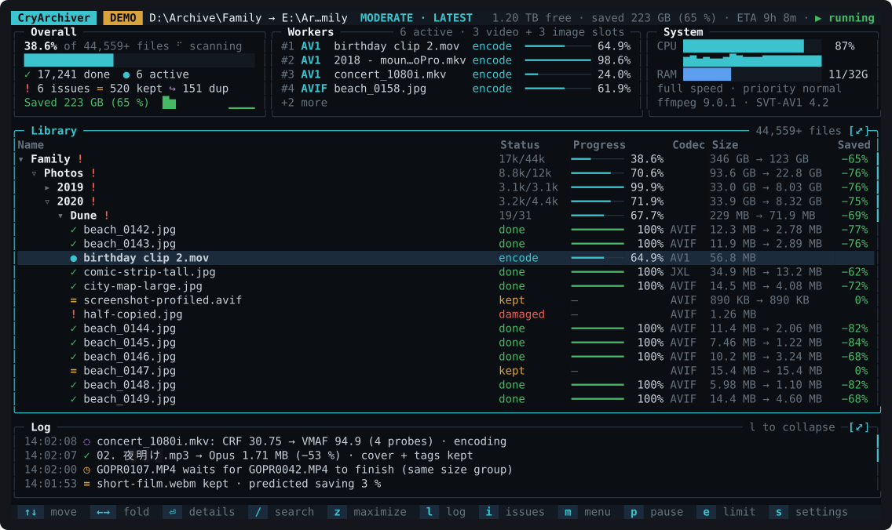

# CryArchiver

Cross-platform CLI and TUI tool, fast and reliable, to make your media files smaller while retaining quality.

Compresses image/video/audio files without having to worry about the right settings.

Dynamically probes the media files, determinest best format, encodes, verifies, retries if needed with better settings to reach the target quality rating. Easy presets to choose from and can be overriden.

With option to lower CPU usage for when you just want to put it into background and still use your device.



| Input | Becomes |
|---|---|
| Video | AV1 in MKV (VP9 when it has transparency) |
| Photos and images | AVIF, or JPEG XL for very large or high bit depth images |
| GIF, APNG, animated WebP | Animated AVIF |
| Music and audio | Opus |
| DVD (`.iso` or `VIDEO_TS`) | One MKV with chapters, menus and filler left out |
| Blu-ray | The main feature as MKV, or the disc kept as is |

Originals are never changed. Video quality is measured with VMAF and images with SSIMULACRA2, so every file is checked against a target instead of guessed.

## Setup

You need ffmpeg 8.1 or newer with libsvtav1, libdav1d, libopus and soxr. libvmaf, libvpx, libjxl and libaom unlock quality checks, transparent video, JPEG XL and animated images. On Windows the gyan.dev "full" build has everything; on Linux use a BtbN static build or your distribution's ffmpeg.

```sh
cargo build --release
cryarchiver doctor          # shows what your ffmpeg can do
```

## Converting files (CLI mode)

```sh
cryarchiver holiday.mp4                  # writes holiday.cry.mkv next to it
cryarchiver photos/ -o small/            # every file in photos/, written to small/
cryarchiver movies/                      # also every DVD or Blu-ray folder directly in movies/
cryarchiver album/ --speed slow          # slower, a bit more quality
cryarchiver film.mkv --ss 1:00 --to 2:30 # cut a part out
cryarchiver clip.mp4 -o clip.avif        # looping animated AVIF
cryarchiver Wedding.iso                  # a DVD image becomes Wedding.cry.mkv
```

Three speeds: `fast` uses fixed settings, `moderate` (the default) and `slow` test a few seconds first and then check the whole result. Personal metadata like GPS and camera details is removed unless you add `--keep-metadata`. Running the same command again skips files that are already done. When a DVD or Blu-ray can't be made smaller at the target quality, it is still written as one MKV, copied from the disc without encoding.

All options:

| Output | |
|---|---|
| `-o, --output PATH` | Output folder, or output file for a single input |
| `-f, --format mkv\|webm\|mp4\|opus\|ogg\|mka\|avif\|jxl` | Force one output format |
| `--overwrite` | Replace existing outputs (never sources) |
| `--min-savings PERCENT` | Keep the original unless the output is this much smaller (default 10) |
| `--keep-metadata` | Keep GPS, camera details and file dates |
| `--drop-aux` | Also convert motion photos and photos with other extras, dropping the extras |
| `--bluray keep\|convert` | Keep Blu-ray discs as they are, or convert the main feature (default convert) |

| Quality | |
|---|---|
| `-s, --speed slow\|moderate\|fast` | Speed versus quality (default moderate) |
| `--video-vmaf MEAN/FLOOR` | Video target: VMAF mean and 5th-percentile floor (presets 91/86 moderate, 93/89 slow) |
| `--image-target N` | Image target: SSIMULACRA2 score, 50–95 (presets 75, 80, 85) |
| `--audio-kbps N` | Stereo Opus bitrate, 64–320 |
| `--crf N` | Encode video at a fixed CRF, no quality search |
| `--video-encoder svt-av1\|aom` | AV1 encoder |
| `--image-encoder avif\|jxl\|jxl-lossless` | Image format and mode |
| `-c, --codec latest` | Codec family |

| Editing | |
|---|---|
| `--ss TIME`, `--to TIME` | Cut audio or video: `90`, `1:30` or `00:01:30.500` |
| `--merge-audio` | Mix all audio tracks into one |
| `--strip` | Keep only the main video and the audio |
| `--burn-subs[=TRACK\|LANG]` | Draw subtitles into the picture |
| `--sub-size PERCENT` | Height of burned text subtitles (default 5) |
| `--resize W:H` | Scale video and images (`-1` keeps the aspect ratio) |
| `--max-bitrate MBPS` | Cap the video bitrate, for sharing |

| Performance | |
|---|---|
| `-j, --jobs N` | Files in parallel |
| `--threads N` | Threads per file |
| `--priority normal\|low\|idle` | Process priority |
| `--cpu-limit PERCENT` | Use at most this share of the CPU |
| `--ffmpeg PATH` | ffmpeg binary or its folder (default: from PATH) |
| `-q, --quiet` / `-v, --verbose` | Less or more output |

## Archival Project (TUI mode)

Select SOURCE and DESTINATION folder. 
- folder structure is mirrored
- media is compressed, everything else is copied
- file timestamps and metadata copied by default (chapters, EXIF data...)
- duplicates become small text placeholders
- progress is saved as it goes, so you can stop at any time and continue later.

```sh
cryarchiver                                       # enter TUI mode
cryarchiver project create D:\Photos E:\Archive   # creates E:\Archive\Photos.cryarchive
cryarchiver E:\Archive\Photos.cryarchive          # opens the dashboard
cryarchiver run E:\Archive\Photos.cryarchive      # runs without the dashboard
cryarchiver --demo                                # the dashboard on made-up data
```
